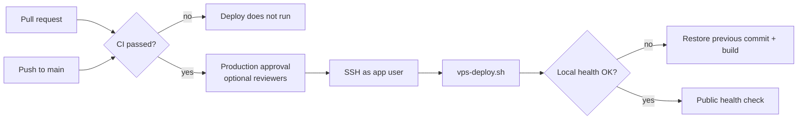

# CI/CD

How changes to EMBR3 ESWMP are tested and shipped. Two GitHub Actions workflows
live in [`.github/workflows/`](../.github/workflows):

| Workflow | File | Runs when | What it does |
|---|---|---|---|
| **CI** | `ci.yml` | every pull request to `main`, every push to `main`, on demand | Server tests; front-end tests, lint report, production build |
| **Deploy** | `deploy.yml` | after CI **passes** on a push to `main`, or on demand | SSH to the server, run `scripts/deploy/vps-deploy.sh`, verify health |



---

## CI (`ci.yml`)

Two independent jobs on Node 22, so a front-end failure never hides a server
failure.

**Server — tests**
1. `npm ci`
2. Syntax check: `node --check` on `server.js` and every file in `routes/`,
   `utils/`, `models/`, `middleware/`.
3. `npm test`, the `node --test` suite in `server/tests/`. The suite stubs the
   database, so CI needs no MongoDB and no secrets. `MONGODB_URI` points at an
   unreachable port, and email variables are blank, so an accidental real
   connection or email fails fast instead of reaching anything.

**Front-end — tests, lint, build**
1. `npm ci`
2. `npm test` (`node --test` over `src/pages/**/__tests__`).
3. `npm run lint`, **report only** (see [Making lint blocking](#making-lint-blocking)).
4. `npm run build`. The `dist/` output is uploaded as the `front-end-dist`
   artifact (kept 7 days) so a reviewer can inspect exactly what would ship.

A newer push to the same branch cancels the CI run still in progress.

### Run the same checks locally

```bash
cd server && npm ci && npm test
cd ../front-end && npm ci && npm test && npm run lint && npm run build
```

Both suites pass without a `server/.env`.

### Making lint blocking

The front-end carries existing lint debt, so the lint step uses
`continue-on-error: true`. Once `npm run lint` is clean, delete that line in
`ci.yml` so new lint errors fail the pull request.

---

## Deploy (`deploy.yml`)

1. **Trigger.** Runs automatically when the CI workflow completes successfully
   for a push to `main`. CI on a pull request never deploys. It can also be
   started by hand from **Actions → Deploy → Run workflow**, optionally with a
   commit SHA, branch or tag, which is how you roll back to a known-good commit.
2. **Approval.** The job runs in the `production` environment. Add required
   reviewers there (**Settings → Environments → production**) so every deploy
   waits for a person to approve it.
3. **One at a time.** Deploys are serialized. A second deploy queues behind the
   first and never interrupts it mid-restart.
4. **SSH.** The runner connects as the app user with a deploy key. The server's
   host key is pinned through `VPS_KNOWN_HOSTS`, so the connection fails rather
   than trusting an unknown host.
5. **Script.** The runner streams `scripts/deploy/vps-deploy.sh` from the commit
   being deployed, so the steps that run are the reviewed ones, never a copy
   edited on the server.
6. **Public check.** Once the script succeeds, the runner checks the public
   `/api/health` endpoint.

### What `vps-deploy.sh` does

| Step | Detail |
|---|---|
| Refuse unsafe runs | Exits if run as root, or if the server checkout has local edits (other than the known `front-end/package-lock.json` churn, which it discards). |
| Move the checkout | `git fetch`, then reset to the requested commit. Moving backwards (rollback) works the same way. |
| Dependencies | `npm ci` in `server/` (production only) and `front-end/` **only when that package's lockfile changed**, or when `node_modules` is missing. |
| Build & publish | `npm run build`, then replaces the web root's contents. The previous build is kept as `<WEB_ROOT>.prev`. |
| Restart | `pm2 restart <PM2_APP> --update-env` then `pm2 save`, under the app user's own PM2 daemon. |
| Health check | Polls `HEALTH_URL` for up to 60 s. |
| Automatic rollback | If any step fails after the checkout moved, it resets to the previous commit, restores the previous build, reinstalls server dependencies if they differed, restarts the API and exits non-zero, which fails the workflow. |

### Repository secrets

**Settings → Secrets and variables → Actions → New repository secret**

| Secret | Value |
|---|---|
| `VPS_HOST` | Server IP or hostname |
| `VPS_USER` | The app user that owns the checkout. Never `root`. |
| `VPS_SSH_KEY` | A private key used **only** for deploys (see below) |
| `VPS_KNOWN_HOSTS` | Output of `ssh-keyscan -t ed25519 <VPS_HOST>`, captured from a trusted network |
| `VPS_PORT` | *(optional)* SSH port if not 22 |

### One-time server setup

Server-specific values (paths, process name, port) are deliberately kept out of
this repository. Do this once, as the app user unless noted:

1. **Deploy key.** Generate a dedicated key pair on your own machine with
   `ssh-keygen -t ed25519 -C "github-deploy" -f eswmp_deploy`. Append
   `eswmp_deploy.pub` to the app user's `~/.ssh/authorized_keys` and store the
   private half as `VPS_SSH_KEY`.
2. **Deploy config.** Create `~/.config/eswmp-deploy.env` with the four values
   the script requires:
   ```bash
   APP_ROOT=/absolute/path/to/the/checkout
   WEB_ROOT=/absolute/path/the/web/server/serves
   PM2_APP=<pm2 process name of the API>
   HEALTH_URL=http://127.0.0.1:<api port>/api/health
   ```
3. **Web root ownership** *(as root, once)*. The script publishes the build
   without `sudo`, so the app user must own the web root's **parent** directory
   (that's where `<WEB_ROOT>.prev` is written). The web server only needs read
   access:
   ```bash
   chown -R <app-user>:www-data <parent of WEB_ROOT>
   chmod -R g+rX <parent of WEB_ROOT>
   ```
4. **Dry run.** As the app user, run `DEPLOY_REF=main bash <APP_ROOT>/scripts/deploy/vps-deploy.sh`
   once by hand and confirm it finishes with `Deployed <sha> successfully`.

The operations team's internal deployment guide records the concrete values
for the production server.

---

## Rolling back

- **Automatic.** A failed health check restores the previous commit and build
  on its own. The workflow run shows as failed, with the PM2 log tail in its output.
- **Manual.** **Actions → Deploy → Run workflow**, enter the last good commit
  SHA. The script moves the checkout back and rebuilds.

## Troubleshooting

| Symptom in the workflow log | Cause / fix |
|---|---|
| `VPS_SSH_KEY secret is not set` | Add the repository secrets above. |
| `Host key verification failed` | `VPS_KNOWN_HOSTS` is missing or stale. Re-capture it with `ssh-keyscan`. |
| `APP_ROOT is not set — add it to …` | Create `~/.config/eswmp-deploy.env` on the server (one-time setup, step 2). |
| `Local edits on the server` | Someone edited files on the server. Commit them properly or discard them, then re-run. |
| `Permission denied` writing the web root | One-time setup step 3 was skipped. |
| Health check fails, then `Rolled back` | The new code did not start. Read the PM2 log tail in the run, fix forward, and push again. |
| Deploy job skipped | CI failed, or the run came from a pull request. Only a successful CI run on a push to `main` deploys. |
